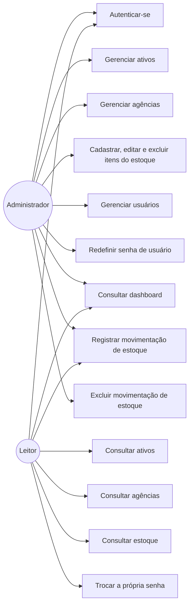
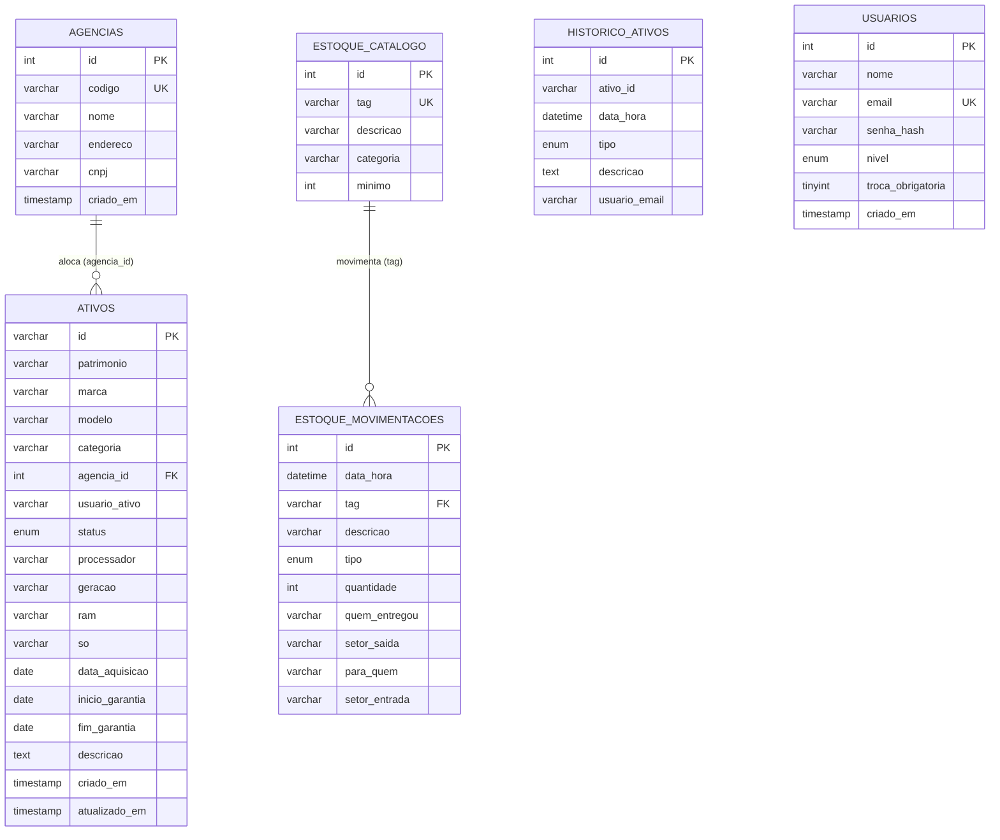

# Gestão de Ativos TI

Sistema web para controle de ativos de TI (computadores, notebooks, impressoras e demais equipamentos) distribuídos entre agências, com controle de estoque de insumos, histórico de movimentações e gestão de usuários com níveis de acesso.

Projeto desenvolvido como Trabalho de Conclusão de Curso (TCC) do curso de Análise e Desenvolvimento de Sistemas, Centro Universitário Guairacá.

**Autor:** Guilherme Toledo Vidal

---

## Descrição do projeto

O sistema centraliza o inventário de equipamentos de TI de uma organização com várias agências. Cada ativo é vinculado à agência onde está alocado, e o sistema registra o histórico de alterações. Paralelamente, controla um estoque de insumos, com cadastro de itens, entradas, saídas e alerta de saldo abaixo do mínimo.

Módulos:

- **Dashboard:** visão geral dos indicadores do inventário.
- **Ativos:** cadastro e acompanhamento dos equipamentos, com status (Em Uso, Em Estoque, Manutenção, Obsoleto).
- **Agências:** cadastro das unidades. Cada agência expande para exibir seus dados e a lista de ativos alocados.
- **Estoque:** cadastro e manutenção do catálogo de itens, registro de movimentações e alerta de saldo mínimo.
- **Histórico:** registro das alterações dos ativos.
- **Usuários:** cadastro, alteração de nível, redefinição de senha e exclusão.

## Problema

Organizações com várias agências costumam controlar seus equipamentos de TI em planilhas espalhadas, sem histórico confiável de quem utiliza cada ativo, onde ele está e em que estado se encontra. Isso dificulta auditorias, a reposição de insumos e a rastreabilidade dos equipamentos.

## Justificativa

Centralizar o inventário em um sistema único permite:

- saber, a qualquer momento, onde está cada equipamento e quem o utiliza;
- controlar o estoque de insumos e receber alertas quando um item cai abaixo do mínimo;
- manter o histórico de alterações para auditoria;
- controlar o acesso por níveis (Admin e Leitor), protegendo as operações críticas.

## Tecnologias utilizadas

| Camada | Tecnologia |
|---|---|
| Backend | Node.js, Express |
| Banco de dados | MySQL 8 |
| Autenticação | JWT (jsonwebtoken) |
| Criptografia de senhas | bcryptjs |
| Frontend | HTML, CSS e JavaScript puro |
| Ferramentas de desenvolvimento | nodemon, morgan, cors, dotenv |

## Regras de negócio

**Autenticação e acesso**

- **RN01:** as rotas da API exigem token JWT válido, exceto login, healthcheck e troca de senha obrigatória no primeiro acesso.
- **RN02:** apenas usuários de nível Admin podem criar, alterar nível, redefinir senha e excluir usuários. No estoque, apenas Admins podem cadastrar, editar e excluir itens do catálogo e excluir movimentações. Qualquer usuário autenticado pode registrar entradas e saídas.
- **RN03:** senhas são armazenadas somente como hash (bcrypt). Nenhuma senha é guardada em texto puro.
- **RN04:** ao redefinir a senha de um usuário, o sistema gera uma senha temporária aleatória, exibida uma única vez, e marca o usuário para troca obrigatória.
- **RN05:** um usuário com senha temporária só acessa o sistema depois de definir uma nova senha, com no mínimo 8 caracteres, incluindo letra maiúscula, minúscula e número.
- **RN06:** um Admin não pode excluir a própria conta nem remover o próprio nível de Admin.

**Agências e ativos**

- **RN07:** uma agência não pode ser excluída enquanto houver ativos alocados nela. A API retorna erro e orienta a transferência dos ativos antes da exclusão.
- **RN08:** cada ativo pertence a uma agência, identificada pela chave estrangeira `agencia_id`.

**Estoque**

- **RN09:** o saldo de cada item é calculado a partir das movimentações (entradas menos saídas).
- **RN10:** um item cujo saldo está abaixo do mínimo cadastrado é sinalizado como "Abaixo do mínimo".
- **RN11:** ao excluir uma movimentação, o saldo é recalculado. Não é permitido excluir uma entrada se isso deixar o saldo do item negativo.
- **RN12:** um item só pode ser excluído do catálogo se não houver movimentações registradas para ele, preservando o histórico.
- **RN13:** a tag de cada item é única no catálogo.

## Casos de uso



## Diagramas

### Diagrama entidade-relacionamento



Observações sobre o modelo:

- A tabela `usuarios` não tem chave estrangeira com as demais. O vínculo com o histórico é feito pelo campo `usuario_email`, sem integridade referencial.
- A tabela `historico_ativos` não tem chave estrangeira para `ativos`. Assim, o registro de baixa permanece no histórico mesmo após a exclusão do ativo.
- Na exclusão de uma agência, a API só permite a operação quando não há ativos alocados (RN07). A chave `agencia_id` tem `ON DELETE SET NULL` como proteção adicional no banco.

## Como executar o projeto

### Pré-requisitos

- Node.js 18 ou superior
- MySQL 8 ou superior
- Git

### Passo a passo

1. Clone o repositório:

```bash
git clone https://github.com/guitoledoo/Fabrica_Software.git
cd Fabrica_Software
```

2. Instale as dependências:

```bash
npm install
```

3. Crie o banco e carregue a estrutura:

```bash
mysql -u root -p -e "CREATE DATABASE gestao_ativos_db;"
mysql -u root -p gestao_ativos_db < database/schema.sql
```

4. Crie o arquivo `.env` na raiz, com base no `.env.example`, e preencha os valores (`PORT`, `JWT_SECRET`, `JWT_EXPIRES_IN`, `DB_HOST`, `DB_PORT`, `DB_USER`, `DB_PASSWORD` e `DB_NAME`). Gere um `JWT_SECRET` forte com:

```bash
node -e "console.log(require('crypto').randomBytes(48).toString('hex'))"
```

5. Crie o primeiro usuário Administrador. Gere o hash da senha:

```bash
node -e "require('bcryptjs').hash('SuaSenhaForte1',10).then(h=>console.log(h))"
```

Depois insira o usuário no banco, substituindo `COLE_O_HASH_AQUI` pelo hash gerado:

```sql
INSERT INTO usuarios (nome, email, senha_hash, nivel)
VALUES ('Administrador', 'admin@exemplo.com', 'COLE_O_HASH_AQUI', 'Admin');
```

6. Inicie o servidor:

```bash
npm start
```

Para desenvolvimento, com recarga automática, use `npm run dev`.

7. Acesse no navegador: `http://localhost:3001`

### Verificação

```bash
curl http://localhost:3001/api/health
```

Resposta esperada: `{"status":"ok","timestamp":"..."}`

## Estrutura do projeto

```text
Fabrica_Software/
├── database/
│   └── schema.sql          # estrutura do banco de dados
├── public/                 # frontend (HTML, CSS e JavaScript)
│   ├── css/
│   └── js/
├── src/
│   ├── app.js              # ponto de entrada do servidor
│   ├── config/             # conexão com o banco
│   ├── controllers/        # regras de negócio
│   ├── middleware/         # autenticação e controle de nível
│   └── routes/             # definição das rotas da API
├── .env.example
├── .gitignore
├── package.json
└── README.md
```

## Autor

Guilherme Toledo Vidal